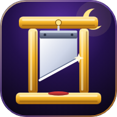
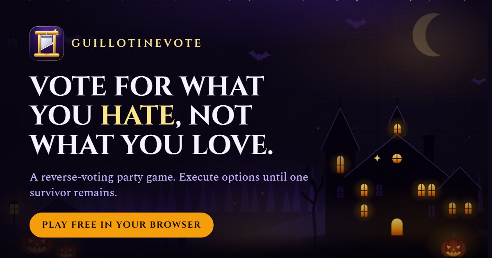
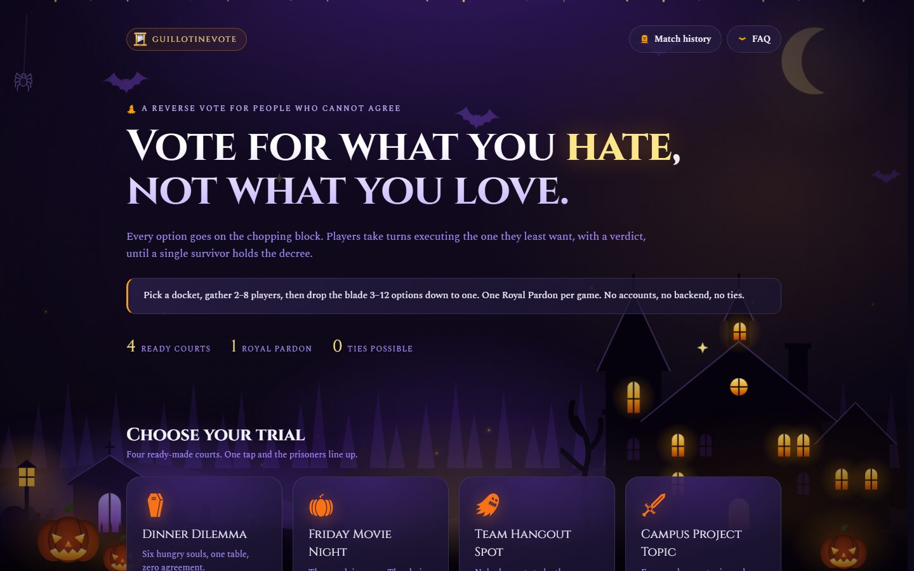
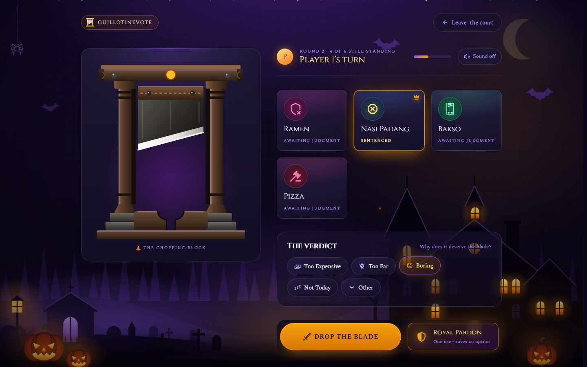
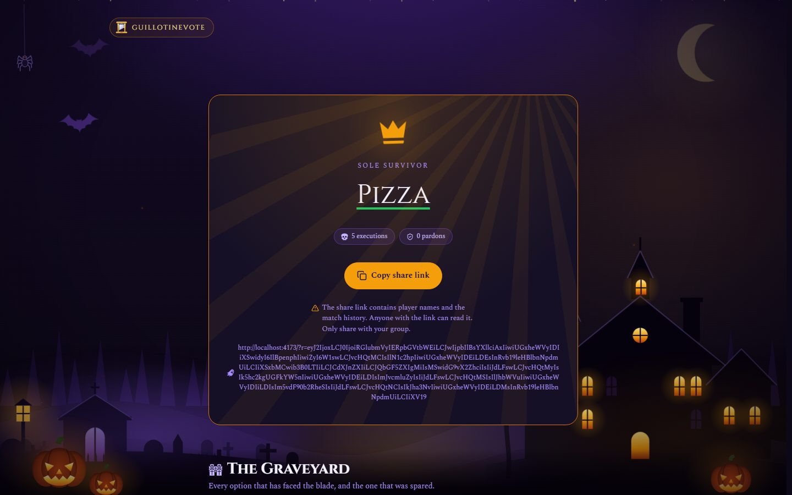
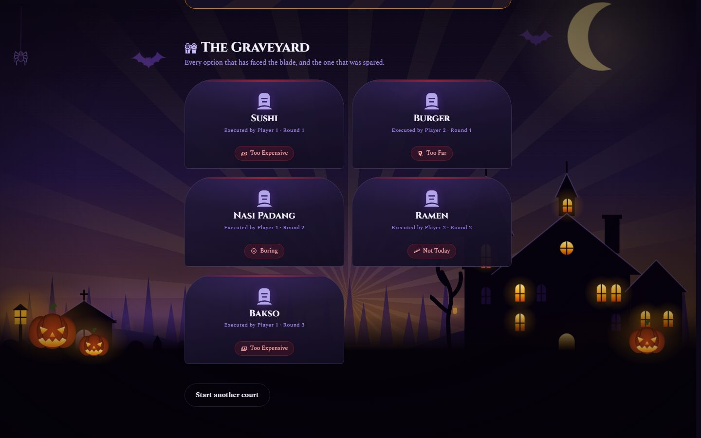
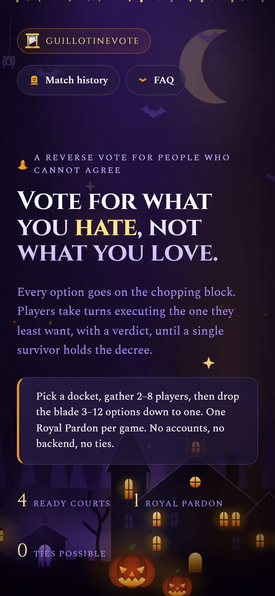
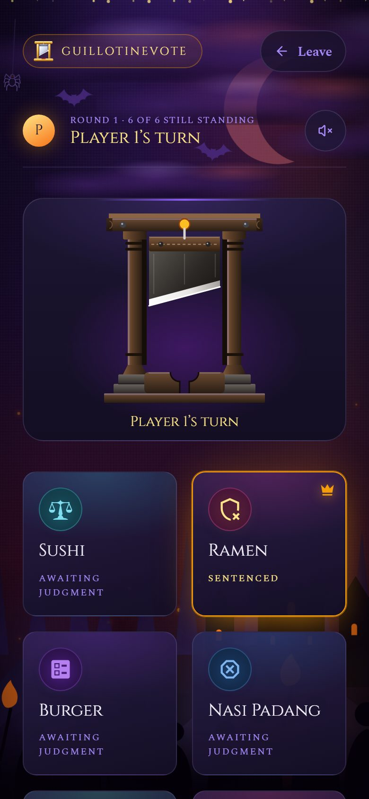
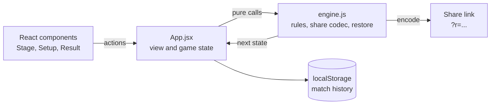

<div align="center">



# GuillotineVote

**Vote for what you hate, not what you love.**

A horror-themed reverse-voting party game for groups that cannot agree.<br>
Take turns executing the option you like least, until one survivor holds the decree.




</div>

## The idea

Normal polls reward the loudest voice and end in ties nobody accepts. GuillotineVote flips the question. Nobody picks a favorite. Each player removes the option they want least, and gives a reason. What is left standing has survived everyone's disapproval, so it is the least objectionable choice, and there is always exactly one.

It runs on a single shared device, in the browser. No account, no server, no database.

## How to play

| Step | What happens |
|---|---|
| 1. **Open the court** | Pick a ready-made docket (dinner, movie night, team hangout, campus project), or write your own: a title, 2 to 8 players, and 3 to 12 options. |
| 2. **Accuse** | On your turn, choose one living option. It becomes a prisoner. |
| 3. **Give a verdict** | Too Expensive, Too Far, Boring, Not Today, or write your own. |
| 4. **Drop the blade** | The option falls to the Graveyard, with who executed it, in which round, and why. Then pass the device. |
| 5. **Royal Pardon** | Once per game, spare the accused option instead of executing it. |
| 6. **Crown the survivor** | When one option is left, it receives the decree. No ties. |

## Screenshots

<table>
  <tr>
    <td width="50%"></td>
    <td width="50%"></td>
  </tr>
  <tr>
    <td align="center"><sub>Pick a docket or write your own</sub></td>
    <td align="center"><sub>Choose a prisoner and a verdict, then drop the blade</sub></td>
  </tr>
  <tr>
    <td width="50%"></td>
    <td width="50%"></td>
  </tr>
  <tr>
    <td align="center"><sub>The decree, with a share link</sub></td>
    <td align="center"><sub>The Graveyard keeps every verdict</sub></td>
  </tr>
</table>

<p align="center">
  
  &nbsp;&nbsp;&nbsp;
  
  <br>
  <sub>Built for the phone first: one column, thumb-sized buttons, and a guillotine that stays in view.</sub>
</p>

## Features

**Game**
- Animated guillotine built with GSAP, with a rope pull, a blade drop, impact shake, sparks, and dust.
- Blade sounds synthesized with the Web Audio API. Sound is off by default.
- A different night scene for each page, with its own parallax depth: a haunted manor, a crypt with ghosts, a pine forest with watching eyes, a torch-lit dungeon, a blood-moon courtyard with a crowd, and a golden dawn for the winner.
- A Graveyard of headstones that records every execution and pardon.
- Match history on your device. Leave a trial midway and resume it later.
- Share link for a finished game. The whole result is packed into the URL, so nothing is uploaded.
- A sample round with fictional players, to try the game in a minute.

**Quality**
- Mobile-first layout, tested down to 320 px wide.
- Keyboard access, visible focus, screen-reader announcements, and `prefers-reduced-motion` support.
- No third-party requests at runtime. Fonts and icons are bundled with the app.
- Search and sharing ready: Open Graph image, structured data, manifest, `robots.txt`, and `sitemap.xml`.

## How it is built

The game rules live in one pure module, `src/engine.js`, with no DOM and no side effects. React components only render state and dispatch actions.



| Layer | Choice |
|---|---|
| UI | React 18, Vite 6 |
| Motion | GSAP and ScrollTrigger |
| Icons | Iconify (bundled data), Lucide |
| Fonts | Cinzel and Spectral through Fontsource |
| Tests | Vitest and fast-check |

The tests cover the engine rules, property-based checks of game invariants, the share-link round trip (including malformed and hostile links), and match history validation.

## Getting started

Requires Node.js 18 or newer.

```bash
git clone https://github.com/zmy16/guillotinevote.git
cd guillotinevote
npm install
npm run dev
```

Open the address Vite prints (by default `http://localhost:5173`). To choose a port:

```bash
npm run dev -- --port 4173
```

| Command | What it does |
|---|---|
| `npm run dev` | Start the dev server |
| `npm run build` | Production build into `dist/` |
| `npm run preview` | Serve the production build locally |
| `npm test` | Run all tests once |
| `npm run test:watch` | Run tests in watch mode |

## Deploying

The app is a static site. Any static host works (Vercel, Netlify, Cloudflare Pages, AWS Amplify). Use `npm run build` as the build command and `dist` as the output folder.

Set `SITE_URL` to your public address before building. It fills the canonical URL, Open Graph image, structured data, and the sitemap.

```bash
SITE_URL=https://your-domain.example npm run build
```

You can also put `SITE_URL=...` in a `.env.production` file. Without it, tags that need an absolute address are left out, and link previews will not show the image.

## Project structure

```text
src/
  engine.js          Pure game rules, share-link encoding, snapshot restore
  history.js         Match history in localStorage
  sound.js           Web Audio blade and fanfare sounds
  iconData.js        Bundled icon data
  components/        Stage, Setup, Result, history and FAQ pages, backdrop
  styles/            CSS by area
tests/               Vitest unit and property-based tests
public/              Logo, favicon set, OG image, web manifest
docs/screenshots/    Images used in this README
```

`node tests/make-icons.mjs` regenerates the PNG icons, `favicon.ico`, and `og-image.jpg` from `public/logo.svg`. It needs the app running at `http://localhost:4173` (or another URL passed as the first argument) and a Playwright browser installed.

## Privacy

- Nothing leaves your device. There is no server.
- Match history and the sound setting are saved in `localStorage` on your device only.
- A share link contains player names and the match history. Anyone with the link can read it, so share it only with your group. Shared result pages ask search engines not to index them.

## Credits

- [React](https://react.dev/), [Vite](https://vite.dev/), [GSAP](https://gsap.com/), [Lucide](https://lucide.dev/)
- Icons from [game-icons.net](https://game-icons.net/) (CC BY 3.0, by Lorc, Delapouite and other contributors) and [Material Design Icons](https://pictogrammers.com/library/mdi/) (Apache 2.0), through [Iconify](https://iconify.design/)
- Fonts: [Cinzel](https://fonts.google.com/specimen/Cinzel) and [Spectral](https://fonts.google.com/specimen/Spectral), both under the SIL Open Font License
